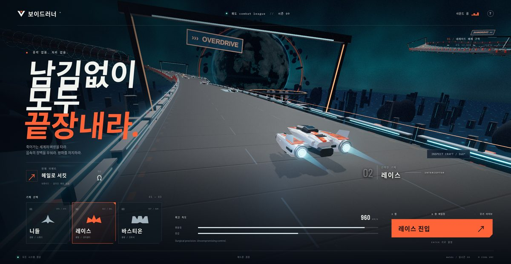

# 보이드러너 — 궤도 combat league (ASTRA)

> **한글화 포크** — [원본 alesha-pro/bench-portal/games/voidrunner-astra](https://github.com/alesha-pro/bench-portal/tree/main/games/voidrunner-astra)의 한국어판.

금이 간 해양 세계 **네레이드** 위에서 펼쳐지는 Three.js 기반 반중력 combat racer. Blender로 제작한 3종 호버크래프트(니들 / 레이스 / 바스티온), 부스트와 에어브레이크 드리프트, 라이벌 전투, 무기와 쉴드, 고도 강하, 커스텀 셰이더, PBR 머티리얼, 블룸, 모션 블러, 360° 3D 크래프트 쇼룸.

## 📸 실제 실행 화면



## 라이브 데모

GitHub Pages로 자동 배포:
**https://sigco3111.github.io/voidrunner-astra/**

## 조작법

| 키 | 동작 |
|---|---|
| `W` / `↑` | 가속 |
| `S` / `↓` | 브레이크 / 감속 |
| `A` / `D` / `←` / `→` | 조향 |
| `Q` / `E` | 좌·우 에어브레이크 (코너에서 누르고 있으면 드리프트) |
| `SHIFT` | 부스트 (떼면 회복) |
| `SPACE` | 무기 발사 / 쉴드 작동 |
| `ESC` | 일시정지 |

주황색 무기 셀과 청록색 쉴드를 모으고, 빛나는 부스트 패드를 활용하라. 라이벌을 들이받고, 최단 코너를 돌고, 3랩을 살아남아라.

## 게임 특징

- **3종 호버크래프트**: 니들(경량 스피더) / 레이스(중형 인터셉터) / 바스티온(중량 인포서)
- **드리프트 물리**: 에어브레이크 기반 회전 감속 + 부스트 가속
- **무기 시스템**: 라이벌 격파용 플라즈마 볼트 + 쉴드(과충전 가능)
- **셰이더**: 커스텀 GLSL + Three.js 후처리 (블룸, 모션 블러)
- **360° 크래프트 쇼룸**: 메뉴에서 모든 기체를 자유 시점으로 감상

## 한글화 범위

- `index.html` 정적 영문 UI 모두 한글화 (메뉴, HUD, 안내문, 모달)
- 게임 내 동적 알림 / 라벨 일부 한글화 (메뉴/세션/승리/사격 등 28개 항목)
- Three.js / WebGL 내부 식별자(`TRANSLATION`, `ROTATION`, `OPAQUE` 등)는 절대 안 건드림 — 빌드 산출물 무결성 유지
- 무기명 / 라이벌 차량명 / 인터벌 라벨 일부 영문 잔존 (원본 빌드 산출물 그대로 활용)

## 빌드 / 실행

원본 alesha-pro/bench-portal은 카탈로그 사이트의 일부로 빌드됨:

```bash
# 원본 카탈로그 안에서 빌드 시
cd ../alesha-pro/bench-portal
npm run build   # dist/ 로 카탈로그 + games/ 통째 복사
```

이 한글화 포크는 **빌드 시스템 없이 정적 자산 그대로 GitHub Pages로 배포**합니다 — `actions/deploy-pages@v4`로 루트 디렉터리를 바로 게시.

## 원본 출처

- 원본: [alesha-pro/bench-portal](https://github.com/alesha-pro/bench-portal) (MIT/None)
- 게임 폴더: [games/voidrunner-astra](https://github.com/alesha-pro/bench-portal/tree/main/games/voidrunner-astra)
- 원본 라이브 데모: [alesha-pro.github.io/bench-portal](https://alesha-pro.github.io/bench-portal/)

## 라이선스

원본 alesha-pro/bench-portal 저장소와 동일한 라이선스를 따릅니다.
